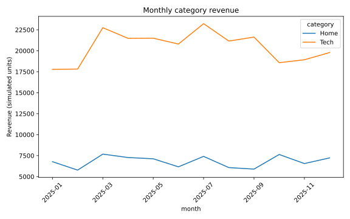

# SQL Sales Performance

> Educational portfolio project, created with AI assistance. Review and adapt the code before presenting it in interviews. Results are demonstrations, not employment achievements.

## Decision question

Build a monthly category revenue report from relational sales data.

## Data provenance

Deterministic synthetic data generated in analysis.py with seed 42. No customer, employer, banking, or personal data is used.

All input generation or loading is included in the script. Features and targets can be inspected directly in [analysis.py](analysis.py).

## Method

SQLite joins, aggregation, CTE and LAG window function; SQL totals reconciled against source rows.

## Run

From the repository root, install `projects/requirements.txt`, then run:

```bash
python projects/06-sql-sales/analysis.py
```

The script writes its outputs relative to its own folder, regardless of the current working directory.

## Results



See [measured metrics](outputs/metrics.json) and generated CSV files under [outputs](outputs). These are actual results from running the committed script.

## Interpretation and limitations

Generated orders exclude returns, taxes and multi-line baskets; revenue is not profit.

## Extend this project

Replace sample inputs with an appropriately licensed dataset, document field definitions and missing-value handling, and re-evaluate the method. Record a decision recommendation supported by the new results. Do not transfer sample performance claims to real populations.
