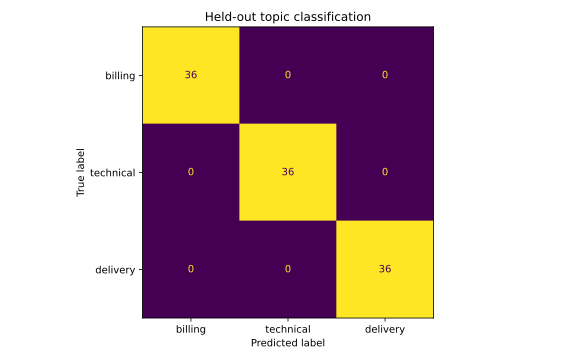

# Document Topic Classification

> Educational portfolio project, created with AI assistance. Review and adapt the code before presenting it in interviews. Results are demonstrations, not employment achievements.

## Decision question

Classify documents using text features with a held-out evaluation.

## Data provenance

Synthetic support requests generated from three explicit topic vocabularies and phrase templates in analysis.py, using seed 42. No real messages or external data.

All input generation or loading is included in the script. Features and targets can be inspected directly in [analysis.py](analysis.py).

## Method

Synthetic support-request corpus; stratified split; training-only TF–IDF and logistic regression; macro F1 and dummy baseline.

## Run

From the repository root, install `projects/requirements.txt`, then run:

```bash
python projects/10-document-classifier/analysis.py
```

The script writes its outputs relative to its own folder, regardless of the current working directory.

## Results



See [measured metrics](outputs/metrics.json) and generated CSV files under [outputs](outputs). These are actual results from running the committed script.

## Interpretation and limitations

Template-generated messages share vocabulary across the split and can duplicate. Scores demonstrate the pipeline only; even perfect accuracy is not evidence of generalisation to real messages.

## Extend this project

Replace sample inputs with an appropriately licensed dataset, document field definitions and missing-value handling, and re-evaluate the method. Record a decision recommendation supported by the new results. Do not transfer sample performance claims to real populations.
