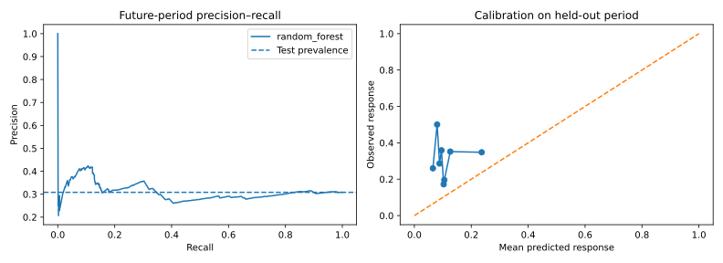

# Bank Campaign Response Modelling

**Can pre-contact information rank future campaign responses better than a constant baseline?**

An independent portfolio case study using real public data, built with AI assistance. It is not an employer project or a claim of commercial delivery.



## Evidence and findings

Read [measured findings and recommendations](reports/FINDINGS.md), [metrics](reports/metrics.json), and the generated CSV reports in [reports](reports/). Results come from executing the committed analysis; no business impact is invented.

## Reproduce

Python 3.12 was used for validation. In a virtual environment:

```bash
python -m venv .venv
# macOS/Linux
source .venv/bin/activate
# Windows PowerShell: .venv\Scripts\Activate.ps1
python -m pip install -r requirements.txt
python download_data.py
python analysis.py
python -m unittest discover -s tests -v
```

The download script accesses the official UCI archive and verifies the extracted file's SHA-256. It writes only to this project's data directory. No account or private data is needed. Runtime libraries are pinned; Python and operating-system differences can still cause small numerical variation.

## Method

- Uses UCI `bank-additional-full.csv` in its original chronological row order.
- Drops call duration because it is unavailable before contact. Also excludes the current-campaign contact count and client demographic/financial fields to keep the feature set focused on channel, prior campaign history, and economic context. This does not establish fairness: included fields can still encode proxies.
- Converts the `pdays=999` sentinel into a prior-contact indicator plus a zero placeholder.
- Compares logistic regression and a constrained random forest on the middle 20% validation block; selects by average precision, then freezes the model.
- Evaluates once on the final 20% with average precision, ROC AUC, Brier score, calibration, and precision/recall at a validation-selected threshold.
- Reports an IID bootstrap interval for average precision, with explicit dependence limitations.

## Data provenance

See [DATA_SOURCE.md](DATA_SOURCE.md) for creators, DOI, CC BY 4.0 attribution, source URL, and checksum. Original raw data is downloaded rather than committed. [source.json](source.json) records the exact extraction configuration.

## Interpretation and limitations

This is response prediction, not churn, creditworthiness, or causal uplift. The data is historical and country-specific. Chronological row order is provided by the source, but exact per-row dates and client IDs are not available. Repeated contacts and feature duplicates may cross split boundaries. Economic conditions can change sharply. The test set is not a substitute for a recent local, consented pilot.

## Files

| File | Purpose |
| --- | --- |
| `analysis.py` | Reproducible analysis and report generation |
| `common.py` | Local output and chart helpers |
| `download_data.py` | Verified public dataset acquisition |
| `reports/` | Measured results, figures, and findings |
| `tests/` | Output integrity and methodological invariants |

## Skills demonstrated

Python, pandas, data validation, reproducibility, evaluation design, visualisation, and evidence-based communication, leakage prevention and baseline comparison.

Code is [MIT licensed](LICENSE); dataset terms remain separate.
