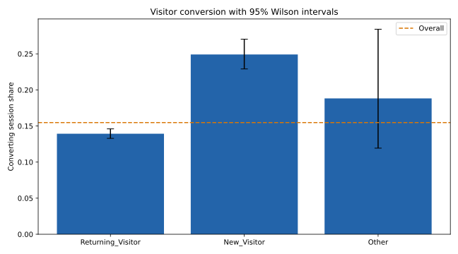

# Ecommerce Conversion Analysis with SQL

**Which visitor segments warrant further investigation before changing acquisition or site strategy?**

An independent portfolio case study using real public data, built with AI assistance. It is not an employer project or a claim of commercial delivery.



## Evidence and findings

Read [measured findings and recommendations](reports/FINDINGS.md), [metrics](reports/metrics.json), and the generated CSV reports in [reports](reports/). Results come from executing the committed analysis; no business impact is invented.

## Reproduce

Python 3.12 was used for validation. In a virtual environment:

```bash
python -m venv .venv
# macOS/Linux
source .venv/bin/activate
# Windows PowerShell: .venv\Scripts\Activate.ps1
python -m pip install -r requirements.txt
python download_data.py
python analysis.py
python -m unittest discover -s tests -v
```

The download script accesses the official UCI archive and verifies the extracted file's SHA-256. It writes only to this project's data directory. No account or private data is needed. Runtime libraries are pinned; Python and operating-system differences can still cause small numerical variation.

## Method

- Audits source rows, missing values, and repeated feature combinations.
- Loads source sessions into SQLite and produces visitor, month, traffic-source, and weekend conversion scorecards.
- Reconciles every segment report to the original session and conversion totals.
- Adds 95% Wilson intervals for segment conversion rates.
- Reports a visitor-type chi-square test and Cramer's V alongside descriptive counts.
- Preserves identical feature rows because no session identifier is available to establish whether they are duplicate records.

## Data provenance

See [DATA_SOURCE.md](DATA_SOURCE.md) for creators, DOI, CC BY 4.0 attribution, source URL, and checksum. Original raw data is downloaded rather than committed. [source.json](source.json) records the exact extraction configuration.

## Interpretation and limitations

This is observational analysis, not an A/B test or funnel reconstruction. Revenue is a Boolean conversion label, not monetary revenue. Month names lack a full timestamp, so retention cohorts and reliable chronological ordering are unsupported. Differences can reflect audience mix, seasonality, or confounding. Exploratory comparisons are not multiplicity-adjusted.

## Files

| File | Purpose |
| --- | --- |
| `analysis.py` | Reproducible analysis and report generation |
| `common.py` | Local output and chart helpers |
| `download_data.py` | Verified public dataset acquisition |
| `reports/` | Measured results, figures, and findings |
| `tests/` | Output integrity and methodological invariants |

## Skills demonstrated

Python, pandas, data validation, reproducibility, evaluation design, visualisation, and evidence-based communication, SQL aggregation and reconciliation.

Code is [MIT licensed](LICENSE); dataset terms remain separate.
